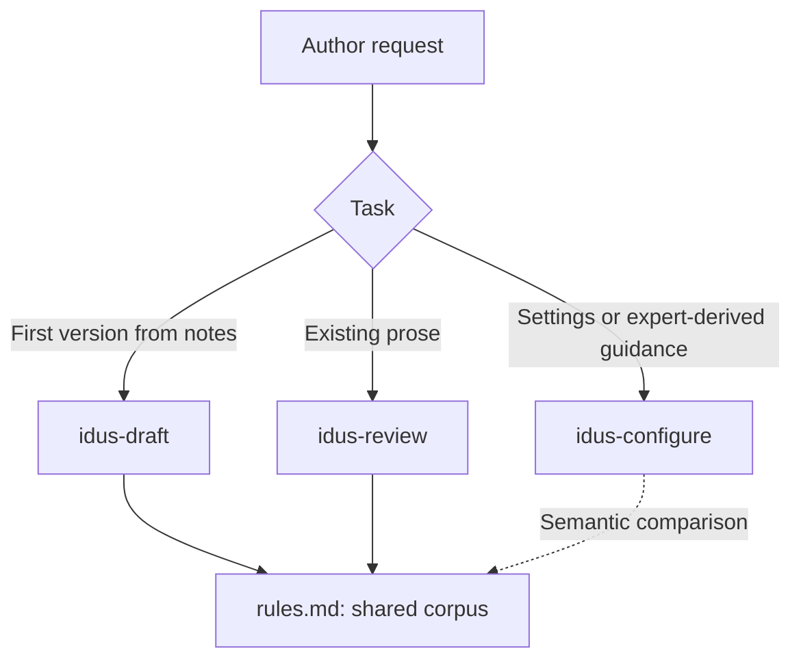
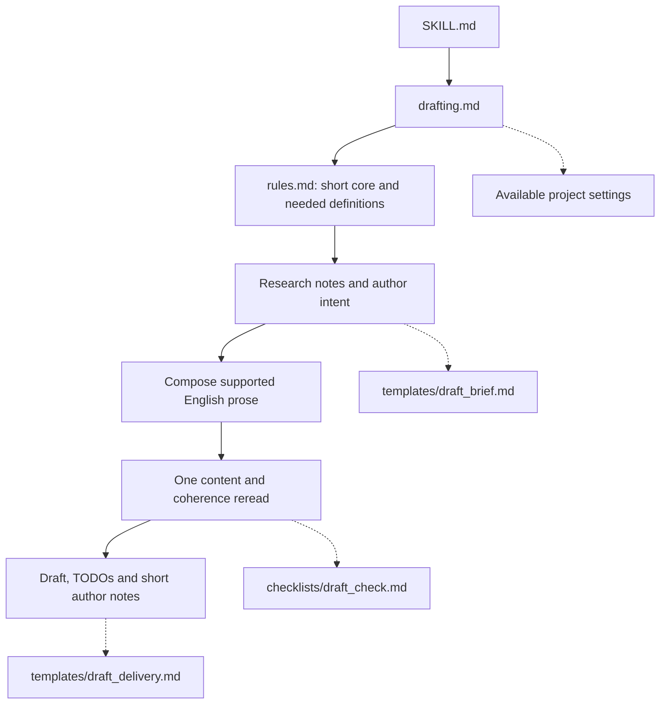
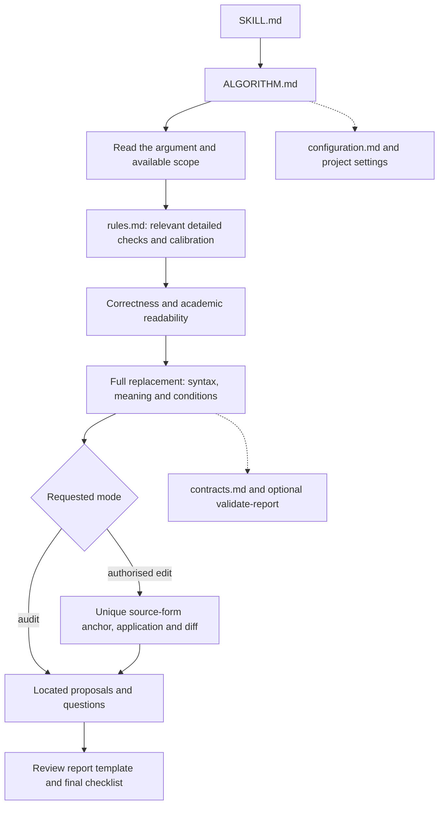
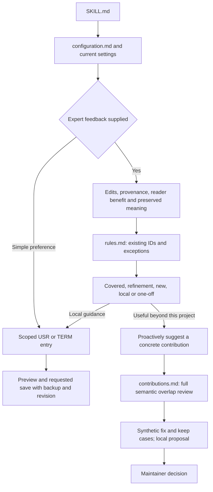
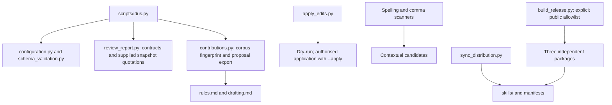

# IDUs skill map

Draft, review and configure use one canonical [writing corpus](../rules.md). Draft reads its short
core and the definitions needed for the requested section. Review uses the relevant detailed
checks and calibration. Configure compares proposed guidance with the same corpus.
The [file index](file-index.md) describes each public file and the source of each generated copy.

These diagrams show prescribed instruction routes, not recorded model execution. Links do not
load resources automatically. The agent selects relevant sections; Python helpers perform file
and contract operations without calling a model or making editorial judgements.

## Where to review instructions

| Source | What to inspect |
|---|---|
| Skill entry templates: [draft](../packaging/skills/idus-draft/SKILL.md.in), [review](../packaging/skills/idus-review/SKILL.md.in), [configure](../packaging/skills/idus-configure/SKILL.md.in) | Scope, routing and expected output. |
| [rules.md](../rules.md) | Shared core, stable IDs, language, structure, evidence, word choice and punctuation. |
| [drafting.md](../drafting.md), [ALGORITHM.md](../ALGORITHM.md) | Different depth for draft and review, using the same rule definitions. |
| [configuration.md](../configuration.md), [contributions.md](../contributions.md) | Local extensions, expert-feedback assessment, semantic overlap and shared proposals. |
| [Standalone master prompt](../prompts/main_agent.md) | Self-contained instructions for use without installation. |

Comment on the canonical source, for example `rules.md / C8` or `ALGORITHM.md / step 3`.
Files in `skills/` and plugin manifests are generated by `scripts/sync_distribution.py`.
Project preferences live in the manuscript workspace, outside the installed skill.

## Choose a mode

## Draft

Draft does not preload the full corpus or run the detailed review workflow. Missing facts stay
specific TODOs; planned work stays distinct from completed work. The skill works without Python
or another installed mode. Its package includes the shared definitions for selective lookup.

## Review

A STYLE proposal can improve grammatical prose when it has a concrete reader benefit. Wording,
evidence, authorisation and application remain separate. Clear prose can stay. A text/PDF export
may differ from TeX or Python source form, so application needs a verified current source anchor.

## Configure and contribute

Configure assesses positive academic improvements as well as slips. A duplicate points to an
existing ID; a refinement preserves it. A useful shared candidate can be suggested without a
separate reminder. Sending a PR requires submission authorisation. Local export does not send
data, activate a rule, edit a manuscript or start another mode.

## Helpers and distribution

All modes contain the same `rules.md`. Draft has no scripts; review has no proposal exporter;
configure has no manuscript applier. Repository checks validate links and generated consistency;
unit tests validate helper and packaging behaviour, rather than model reliability.
Private outputs, archives and project settings remain outside the public allowlist. These maps
and the file index are maintainer documentation, not runtime resources.
